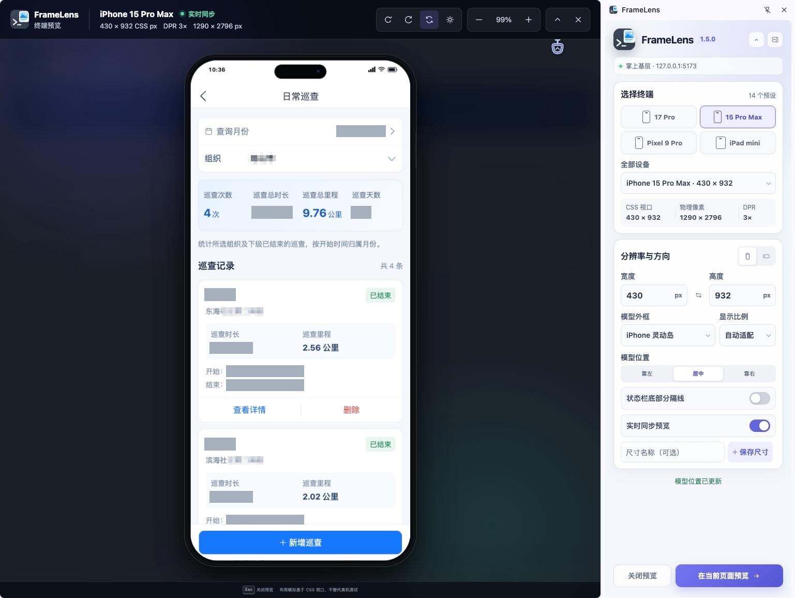
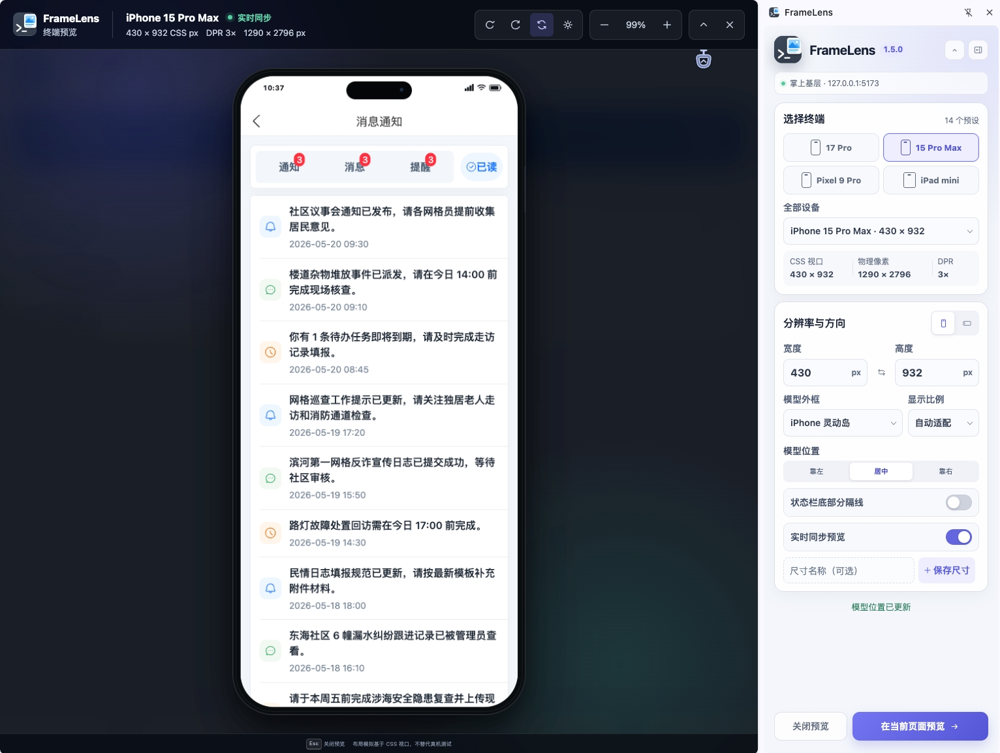

# FrameLens · 页面终端预览

FrameLens 是一个 Chrome 扩展：在当前标签页里，把正在访问的网页放进指定尺寸的模型机，直接检查响应式布局。可以在模型里点击、登录、切换路由，也可以把模型靠右放置并收起工具栏，单独看页面效果。

**当前版本 1.5.0 · Chrome 114+ · 无需安装依赖或构建。** 它模拟的是网页布局视口，不是 iOS Safari 或 Android 真机。

[安装与更新](#安装与更新) · [开发与测试](docs/development.md)

## 界面预览

**日常巡查**

**消息通知**

## 安装与更新

1. 从本仓库点 **Code → Download ZIP** 并解压到打算长期保留的目录。也可以执行 `git clone https://github.com/letgoing/FrameLens.git`。
2. 在 Chrome 地址栏输入 `chrome://extensions/`，开启右上角的「开发者模式」。
3. 点「加载已解压的扩展程序」，选择**直接包含 `manifest.json` 的目录**。Git 克隆通常是 `FrameLens/`，GitHub 下载解压后通常是 `FrameLens-main/`。不要选 ZIP、上一级目录或 `scripts/`。
4. 在普通网页打开扩展菜单，固定 FrameLens 图标。点图标，右侧会打开设置栏。

**升级不用卸载。** Git 安装可在原目录执行 `git pull --ff-only`；ZIP 安装请把新文件覆盖到 Chrome 已加载的原目录。然后到 `chrome://extensions/` 点 FrameLens 卡片上的「重新加载」。已保存的自定义尺寸和默认偏好会保留；进行中的预览会话需要重新开启。

## 第一次预览

1. 打开你要检查的网页，例如本地开发地址。点 FrameLens 图标，在右侧选择 **iPhone 15 Pro Max**。
2. 点「在当前页面预览」。模型里显示的是可交互网页，不是截图。尝试点击页面链接，或者旋转模型检查底部标签栏。
3. 想只看页面，可点顶部「隐藏」；右上角的小拉环会留在顶边，点一下就能展开。拉环也支持 Tab 聚焦、Enter 或空格操作。
4. 结束时点顶部 **×**、右侧「关闭预览」，或按 **Esc**。在模型内从登录页进入了同源首页，关闭后，原标签页就停在该首页，而不是退回登录页。

**快捷键：** macOS 默认 `Command + Shift + M`，Windows / Linux 默认 `Ctrl + Shift + M`，用于打开或关闭当前标签页预览。若没反应，可到 `chrome://extensions/shortcuts` 查看或重新分配快捷键。

## 设置怎么生效

| 操作 | 何时生效 | 会记住什么 |
| --- | --- | --- |
| 侧栏选设备、改宽高、横竖屏、外框、缩放 | 点「在当前页面预览」时 | 应用到当前模型，并设为下次打开预览的设备参数 |
| 输入名称后点「保存尺寸」 | 立即加入设备列表的「我的尺寸」 | 保存为可重复选择的预设；不会自动应用。选中已保存的条目可删除 |
| 改模型位置、状态栏底部分隔线、实时同步 | 立即生效，不用点应用 | 仅保存该项。预览已开启时更新当前标签页，未开启时只更新默认值 |
| 顶部旋转、缩放、明暗背景、收起工具栏 | 立即作用于当前预览 | 刷新标签页后保留本次视图；关闭再开时，顶部工具栏默认展开 |
| 收起右侧设置 | 只改变设置面板 | 可保留设备摘要，或关闭整个侧边栏；都不是「关闭预览」 |

例如，模型当前是 **412 px** 宽，在侧栏输入 **518** 后只切换「实时同步预览」，当前模型和默认宽度仍然是 **412**；只有点「在当前页面预览」才会变成 **518**。

### 设备、外观与布局

- **尺寸**：内置 14 个设备预设，涵盖 iPhone 17/16/15 Pro 系列、iPhone 14 / 13 / 12、SE、Pixel 9 Pro、Galaxy S24 Ultra、Android 小屏、iPad 和桌面。自定义宽高各支持 **240–2560 CSS px**，可以交换宽高。
- **视口与缩放是两回事**：iPhone 15 Pro Max 的预设视口是 **430 × 932**，iPhone 17 Pro 是 **402 × 874**。例如前者选 75% 缩放，只会让模型在桌面上显示得更小；模型内网页仍按 430 px 宽排版。预设上的物理像素、DPR 是设备参考信息，不会改写浏览器的实际 DPR。
- **外框与位置**：可选 iPhone 灵动岛、Android 打孔屏、平板、桌面浏览器或无外框。模型默认居中，亦可即时靠左、靠右。侧栏支持自动适配以及 100%、90%、75%、50% 缩放，顶部另有放大和缩小按钮。
- **状态栏**：手机和平板外框显示时间、信号、Wi-Fi 和电池图标。背景跟随页面顶部底色，文字和图标自动切换深浅；状态栏不占用设定的网页视口高度。「状态栏底部分隔线」默认关闭，该开关不修改网页自己的导航边框。顶部明暗按钮切换的是预览背景，不会给网页强制换肤。

## 刷新、跳转和关闭的区别

| 场景 | 结果 |
| --- | --- |
| 点模型顶部「刷新」 | 仅重新加载模型里的网页，不刷新整个浏览器标签页 |
| 模型内从列表进入同源详情，再普通刷新或强制刷新浏览器 | 恢复当前标签页的模型、设置和详情地址，保留查询参数和 `#` 路由 |
| 主动在外层标签页打开另一个同源页面 | 保留预览，以新打开的外层地址为准，不跳回旧详情 |
| 通过顶部 ×、侧栏或 Esc 关闭 | 三个入口一致：可读取时接续模型当前地址；关闭后再刷新不会自动打开预览 |
| 模型内跳到了跨域或受限页面 | 无法安全读取内页地址时，关闭或刷新都以外层地址为准，不猜测上一个地址 |
| 新开标签页、切换到其他站点、关闭标签页 | 新标签不自动开启，不把旧站点的预览套到新站点；关闭标签页会清理这次会话 |

这里的「同源」指**协议、主机和端口都相同**。例如开发服务器的 5173 与 5174 是两个源。插件接续的是页面**地址**；未提交的表单、网页内存状态和滚动位置不保证随刷新或退出保留。

## 实时同步：哪些变化会刷新？

默认开启。原页面或其他同源标签页修改共享存储、原页面表单触发 `change`、原页面路由变化时，FrameLens 会合并短时间内的变化再同步。公共数据有更新时，模型通常通过重新加载自己的网页来读取最新值；不会给原页面的 `fetch` 或 `XMLHttpRequest` 打补丁。

时钟跳动、动画、提示文字变化等普通页面重绘**不会触发刷新**。只修改后端数据、另一个插件的私有状态或网页内存，也不一定产生可识别的信号。此时可点模型顶部「刷新」。如果正在模型里填一份不能丢的表单，先暂停同步，保存后再恢复。

## 常见问题

| 现象 | 怎么处理 |
| --- | --- |
| 能打开侧栏，但当前页面无法预览 | 换到普通 HTTP(S) 网页。Chrome 设置页、扩展页和 Chrome Web Store 等受保护页面不能注入预览 |
| 本地 HTML 无法预览 | 到扩展详情打开「允许访问文件网址」，再打开 `file://` 页面。使用本地开发服务器时可直接预览 HTTP 地址 |
| 模型内部空白或显示拒绝连接 | 目标网站可能通过 `X-Frame-Options` 或 CSP 的 `frame-ancestors` 禁止嵌入。插件不绕过网站的安全策略 |
| 进入第三方登录页后，Esc 无效或不能接续该页 | 跨域页面内的键盘事件和地址不能由外层读取。用顶部 × 或侧栏「关闭预览」退出 |
| 想检查真机上的触摸、软键盘或 Safari 差异 | 请在真机验证。FrameLens 主要用来确认断点、横竖屏布局和固定元素的位置，不模拟浏览器内核、User-Agent 或软键盘 |

## 权限与隐私

预览只在本机完成。扩展不收集或上传页面内容、浏览记录，也不需要账号。设备偏好与自定义尺寸写入 `chrome.storage.local`；本次预览的可恢复地址和状态写入 `chrome.storage.session`，不作为长期历史保存。

`sidePanel` 用于原生侧栏，`activeTab` 和 `scripting` 用于在当前网页打开或更新预览，`storage` 用于上述设置和会话。HTTP(S) 站点访问权限用于页面预览和刷新恢复；本地文件需要用户另行允许。所有运行代码随仓库提供，没有远程脚本。

## ☕ 请我喝杯咖啡

如果 FrameLens 对你有帮助，欢迎扫个码，请我喝杯咖啡。提建议、报问题也都是对这个小工具的支持。谢谢你！

